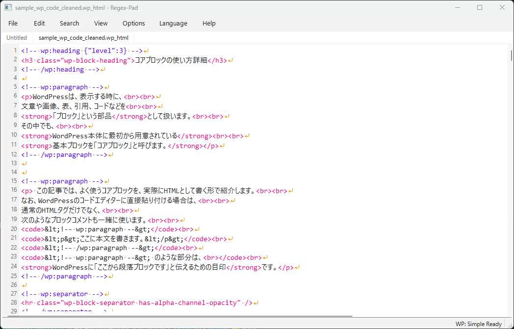

# RegexPad

**Release: 1.0.0 (Stable)**

Release date: October 25, 2026

[日本語](README_jp.md) · [User guide](docs/HOW_TO_USE.md) · [日本語の使い方](docs_jp/HOW_TO_USE_jp.md)

RegexPad is a portable text editor for Windows 11, with regular expression search
and replacement and tools for preparing HTML, CSS, and WordPress article source.
It combines tabbed editing, insertion helpers, structural checks, and local
WordPress previews in an English/Japanese interface.



## Start using RegexPad

1. Extract the **entire distribution ZIP** into a folder you can write to.
2. Keep `regex-pad.exe`, `module_cleaner.exe`, and `_internal` together.
3. Run `regex-pad.exe`, then open a file with **File > Open** (`Ctrl+O`).
4. Edit and save with `Ctrl+S`. Use **Language** to choose English or Japanese.

The complete EXE distribution includes Python/Qt and the WordPress preview
environment. Recipients do not need to install Python, WordPress, PHP, MySQL, or
Node separately. Do not run from inside the ZIP or copy only the EXE.
Administrator privileges and registry changes are unnecessary.

Ordinary editing works offline. A lightweight build without the preview
environment needs internet access when Preview is first requested. A complete
bundle uses its local environment; article images or styles hosted on external
websites still need network access.

## Main features

| Area | Available tools |
|---|---|
| Editing | Multiple tabs/windows, Undo/Redo, encoding selection, rectangular copy |
| Search and replace | Python `re`, exclusions, selection/visible scopes, highlights, replacement preview |
| Regex assistance | Insertion menu, recipes, English/Japanese reference, syntax feedback |
| HTML and CSS | Tag/CSS insertion, text/background color palettes, multiline tag highlighting |
| WordPress preparation | Gutenberg block structure checks, block-attribute JSON checks, Markdown table/list conversion |
| Preview | Neutral, exported simple pages and live Twenty Twenty-Five pages rendered by local WordPress |
| Recovery and appearance | Automatic session backups, saved-file generations, restore, ruler, wrapping, visible whitespace, colors |

See the [user guide](docs/HOW_TO_USE.md) for step-by-step instructions and shortcuts.

## Check article source before pasting

Choose **Search > Grammar Check** (`F7`) to see **Error**, **Warning**, and **Info**
findings for the active tab. Click a result to visit its line, edit the source,
then refresh the check. A pre-save check is available in Options.

The checker covers common HTML/CSS mistakes, WordPress block boundaries and
parent/child relationships, and JSON syntax and selected attributes inside block
comments. It is a paste-safety aid with a bundled dictionary, rather than a full
browser validator or the Gutenberg editor's `save()` validation.

Grammar Check and Preview do not automatically repair or rewrite the article.
Search and replacement preview also leave it unchanged. Text-changing actions
such as Replace, Regex Rewrite, snippet insertion, and Markdown conversion are
performed explicitly by the user. File saving applies the selected encoding and
line-ending setting.

## Two WordPress preview modes

| Mode | Menu / shortcut | What happens |
|---|---|---|
| Simple | **View > WordPress Preview (simple / auto stop)** · `Ctrl+Alt+P` | Renders current editor text with the neutral theme, exports HTML, stops that preview's WordPress process, then opens the page |
| Live theme | **View > WordPress Preview (Twenty Twenty-Five / live)** · `Ctrl+Alt+Shift+P` | Renders the standard theme page and keeps WordPress running for further previews and frontend interaction |

Simple mode shows article content with WordPress core block CSS and inline
styles, with about two full-width characters of padding at each side. Its
exported pages remain viewable after WordPress stops. JavaScript and event
handlers are omitted; use live mode when their behavior matters. Live mode uses
the bundled theme and demo environment, without your production site's plugins.

**After editing, run Preview again.** Each invocation renders the current unsaved
text. Refreshing an old browser page does not submit changes from the editor.

About ten seconds after startup, RegexPad quietly starts an **already-prepared**
simple-preview environment. This timer is a start delay, not a readiness promise,
and automatic prestart does not download missing components. Watch the permanent
**WP** status at the right of the status bar. Live WordPress normally stops when
its RegexPad window closes; **View > Exit WordPress** lets you stop it earlier.
A simple export does not stop a separate live-theme preview.

## Portable settings, backups, and cleanup

Settings are stored in `config.json` beside the application. Editable color
presets use `color_presets.json`. Default backups are under `_internal`;
their interval, retention, and saved-file backup location are configurable.

The EXE creates an actual path inventory at
`_internal/DELET_ITEMS_LIST.md` and `install_records/DELET_ITEMS_LIST.md`,
with a JSON record alongside. Potentially shared references are grouped in its
final warning section. The inventory records paths/package metadata, not
configuration contents.

For cleanup instructions, retained exports, and the cleaner's confirmation step,
read [Backups and recovery](docs/HOW_TO_USE.md#backups-and-recovery) and
[Storage and cleanup](docs/HOW_TO_USE.md#storage-and-cleanup). Keep documents and
backups you need before removing the portable folder or preview data.

## For developers

Source runs use Python 3.12 and PySide6. This project's configured interpreter is:

```powershell
& "D:\Dev\venvs\venv_txt_edit312\Scripts\python.exe" main.py
```

Run checks with the same environment:

```powershell
& "D:\Dev\venvs\venv_txt_edit312\Scripts\python.exe" -m pytest
& "D:\Dev\venvs\venv_txt_edit312\Scripts\python.exe" -m ruff check .
& "D:\Dev\venvs\venv_txt_edit312\Scripts\python.exe" -m pyright --pythonpath "D:\Dev\venvs\venv_txt_edit312\Scripts\python.exe"
```

`./build.ps1` prepares and bundles the WordPress environment by default.
`./build.ps1 -SkipWordPressRuntime` produces a smaller build that prepares it
on demand. First preparation requires internet access. See
[Development and packaging](docs/HOW_TO_USE.md#development-and-packaging)
for direct-spec builds and optional real-engine checks.

The source is split across `editor/`, `dialogs/`, `search/`, `fileio/`,
`settings/`, and `preview/`. Dictionaries and UI resources live in
`dictionaries/` and `resources/`.

[Development record](SCRIPT_STEP.md) records validation and acceptance boundaries.
The record also covers the Gutenberg recovery observations that motivated
the structural checks.
