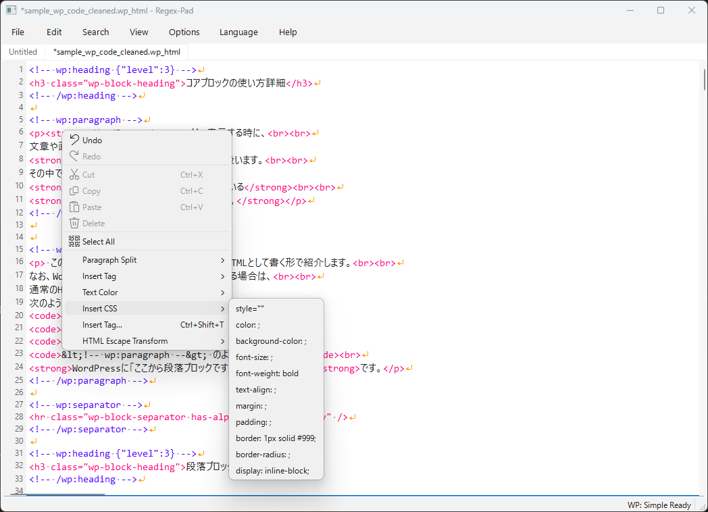

# RegexPad User Guide

**Release: 1.0.0 (Stable)**

Release date: October 25, 2026

[README](../README.md) · [日本語の使い方](../docs_jp/HOW_TO_USE_jp.md)

This guide covers the Windows EXE distribution and the equivalent source
application. Paths below are relative to the folder containing `regex-pad.exe`,
unless described otherwise. Menu names use the English interface; choose
**Language > English** to match them.

## Contents

- [First launch](#first-launch)
- [Files, tabs, and encodings](#files-tabs-and-encodings)
- [Search and replace](#search-and-replace)
- [Tags, CSS, and article conversion](#tags-css-and-article-conversion)
- [Grammar Check](#grammar-check)
- [WordPress previews](#wordpress-previews)
- [Appearance and reference tools](#appearance-and-reference-tools)
- [Backups and recovery](#backups-and-recovery)
- [Storage and cleanup](#storage-and-cleanup)
- [Keyboard shortcuts](#keyboard-shortcuts)
- [Troubleshooting](#troubleshooting)
- [Development and packaging](#development-and-packaging)

## First launch

1. Extract the entire ZIP to a writable folder. Keep the EXEs and `_internal`
   in their supplied arrangement.
2. Start `regex-pad.exe`. The complete bundle needs no separate Python or
   WordPress installation.
3. Choose the interface language from **Language**.
4. Open your document with `Ctrl+O`, or create a tab with `Ctrl+N`.
5. Use `Ctrl+,` to review Options, including encoding, line endings, appearance,
   checks, and backups.

Ordinary editing does not need internet access. The complete bundle supplies
the local preview engine. A lightweight build downloads the missing engine on
the first explicit Preview request; initial preparation can take time.


The editor area displays source text. The status bar shows position/count
information on the left and WordPress state on the right. Screen colors and
visible whitespace depend on your settings.

## Files, tabs, and encodings

| Task | Operation |
|---|---|
| Create a document | **File > New**, `Ctrl+N` |
| Open a document in a tab | **File > Open**, `Ctrl+O` |
| Save the active document | **File > Save**, `Ctrl+S` |
| Choose a destination or output encoding | **File > Save As**, `Ctrl+Shift+S` |
| Reload from disk | **File > Reload**, or **Reload with Encoding** |
| Close, duplicate, or move a tab | Right-click its tab label |

An asterisk (`*`) on a tab/title indicates unsaved changes. Save explicitly
when you want the original document updated; automatic recovery copies do not
save the original file. A duplicated tab is an unsaved copy. Tab closing uses
the recovery mechanism for modified content, so save before closing rather
than relying on a conventional Save prompt.

For garbled text, use **Open with Encoding** or **Reload with Encoding**.
Available encodings are UTF-8, UTF-8 with BOM, CP932 / Shift_JIS, Shift_JIS,
EUC-JP, UTF-16, UTF-16 LE, and UTF-16 BE. Save retains the encoding selected
when opening/reloading until another is chosen. Options also controls the
line-ending style used on save: LF, CRLF, or CR. Select the intended encoding
before saving a document that was displayed incorrectly.

Undo is `Ctrl+Z`; Redo is `Ctrl+Y` or `Ctrl+Shift+Z`. For rectangular copy,
select text whose endpoints define the opposite corners, then choose
**Edit > Copy as Rectangle** (`Ctrl+Alt+C`). This copies a column slice without
deleting the source.

## Search and replace

Open **Search > Find / Replace** (`Ctrl+F`). The fields are **Find text**,
**Exclude**, then **Replace with**.

1. Enter a literal search string, or enable **Regular expression** for Python
   `re` syntax.
2. Set case sensitivity and whole-word matching as needed.
3. For a limited operation, select the target text before enabling
   **Search only selected text**, or use **Search only visible text**.
4. Use **Find** or the previous/next arrows to inspect matches.
5. Choose **Preview** to compare before/after replacement rows.
6. Use **Replace** for a match, **Replace All** for the selected scope, or
   **Replace Marked** for the current search markers.

Search, highlighting, and Preview do not alter the document. Invalid patterns
or replacement references produce an error. After a replacement, use Undo if
the result is unwanted. Selection/visible options constrain searches to that
scope; clear them to return to a whole-document operation.

### Regex examples

| Goal | Find text | Replace with |
|---|---|---|
| Find one or more digits | `\d+` | Leave unused for search |
| Collapse repeated ordinary spaces | ` {2,}` | One ordinary space |
| Convert a date from year-month-day | `(\d{4})-(\d{2})-(\d{2})` | `\g<3>/\g<2>/\g<1>` |

Enable regex mode for these examples. Python replacement references such as
`\1` and `\g<1>` are supported, as are `$1` and `${name}` compatibility forms.
Use `$$` for a literal dollar sign in regex replacement. In literal mode, input
is treated as literal text. The **Insert Regex**, **Regex Recipes**, and
**Regex Help** buttons provide candidates and explanations; review the chosen
recipe before executing a replacement.

### Exclude matches

With regex mode enabled, this example finds newlines except those immediately
following the given tags:

```text
Find text:   \n
Exclude:     <br><br>\n|>\n
```

`|` joins alternatives. A leading `-` has no exclusion meaning. A search match
is skipped when its character range overlaps an exclusion match. Exclude does
not protect an entire line, and a zero-width exclusion protects no characters.
Leave Exclude empty to disable it.

Regex mode and case sensitivity apply to Exclude; whole-word applies to Find
text only. With regex mode off, Exclude is one literal string. Exclusions also
apply to search highlights, replacement Preview, and the search replacement
commands. In selection/visible scope, exclusions are evaluated within that
scope. For text containing CRLF characters, use `\r?\n` consistently in both
patterns. Dialog inputs are retained for the session, not across restarts.

### Regex Rewrite

**Regex Rewrite** is a separate, explicit text transformation. It offers
Japanese punctuation/width conversions, including half-width katakana and
full-width letters, digits, symbols, and spaces. It applies to the active
selection/visible scope, or the whole document when no scope is enabled.
It changes document text when selected; inspect the result and use Undo as
needed. The Exclude field belongs to search/replace and does not protect text
from this separate transformation.

## Tags, CSS, and article conversion

Right-click inside the document for **Insert Tag**, **Text Color**,
**Insert CSS**, **Paragraph Split**, and **HTML Escape Transform**.
**Edit > Insert Tag...** (`Ctrl+Shift+T`) opens a searchable snippet selector.
Candidates include HTML, Markdown, and WordPress HTML; their ordering depends
on document type. Review the explanation and inserted parameters.



- Select text and press `Ctrl+B` for a `<strong>` wrapper or `Ctrl+U` for `<u>`.
- **Text Color** and the default `Ctrl+Alt+1` through `Ctrl+Alt+7` shortcuts
  wrap selected text with colored spans. `Ctrl+Alt+R` is the default red alias.
- **Insert CSS > color: ;** and **background-color: ;** offer swatches. Press
  `Esc` to dismiss the palette and enter a custom CSS color.
- `F8` inserts `<br>`; `F9` inserts `<br><br>`. These shortcuts also work in
  the Find/Replace input where supported.
- **HTML Escape** turns selected markup into display text; **HTML Unescape**
  reverses entity escaping. **WordPress Code Block** prepares a code example.

For Markdown conversion, select a table or list, then open **Paragraph Split**.
Choose **Table Transform**, **List Transform**, or **Markdown Table/List to
WordPress Blocks** as appropriate. The embedded converter replaces the
selection with WordPress block HTML. **List to Framed Block** accepts a
Markdown list or WordPress list block and produces one Custom HTML frame with
visible bullet/number text. Check the converted structure with `F7` and Preview.

The converters, wrappers, and insertion helpers intentionally edit source.
Review their output before saving or pasting into WordPress.

### Dictionaries and color presets

The snippet dictionaries are `html_dict.json`, `markdown_dict.json`, and
`wordpress_html_dict.json` under `dictionaries` in source runs, or the bundled
data area in EXE runs. Options can select a user dictionary folder and enable
dictionary validation. Use a copy for customization.

The editable `color_presets.json` is beside the EXE; a missing editable copy is
created from the bundled default. `text_colors` controls text palettes and
shortcuts; `background_colors` controls background palettes. Entries have an
`id`, English/Japanese names, and a CSS `value`; text entries can specify
`shortcuts`. Restart after editing. Invalid editable JSON is preserved, with
the bundled default used for that launch.

The hover-hint option controls tag menu and insertion-dialog hints. The
selected candidate's explanation remains available with hints off. Editor
text and lint markers currently do not provide hover explanations.

## Grammar Check

1. Activate the document's tab and choose **Search > Grammar Check** (`F7`).
2. Review findings in severity order. Click a result to jump to its source line.
3. Keep the window open while editing, then use **Refresh** or run `F7` again.
4. Use **Copy Results** to retain/share the report. Results belong to each tab;
   edits invalidate an older result.

| Severity | Meaning |
|---|---|
| Error | Structural or syntax damage requiring attention, such as a broken block boundary |
| Warning | Suspicious spelling, placement, or compatibility that needs review |
| Info | Supplementary guidance; Info alone does not trigger the pre-save confirmation |

Checks include HTML tag/attribute typos and nesting, incomplete tags, misplaced
attributes after an opener, CSS structure/properties/values, Gutenberg comment
pairs, selected parent/child constraints, root element shapes, and JSON syntax
and selected attribute values in WordPress comments. `.css` documents use the
CSS checker; inline `style` and `<style>` content are also checked. JSON checking
here concerns WordPress block attributes, not a general JSON-file validation
command. Optional HTML/WP typo checking before save can be changed in Options.

Multiline HTML attributes, including quoted `style` values, are supported.
Source newlines and the spelling difference between `<br>` and `<br />` alone
are not errors. Syntax colors are a separate display function.

There is no automatic repair button in this checker. Correct the source and
run it again. Its bundled rules do not reproduce every Gutenberg block's
`save()` output, theme CSS, custom plugin schema, or browser parsing behavior.
WordPress execution feedback from Preview appears separately and does not
replace the structural findings: a page can render despite damaged markup.

When transferring an article to a real site, keep your source copy and inspect
the code editor and visual result before saving. Gutenberg's **Attempt
Recovery** belongs to WordPress; its recovered serialization can differ from
the original text. See the [development record](../SCRIPT_STEP.md)
for the locally observed cases and analysis scope.

## WordPress previews

Both modes render the **current unsaved contents of the active tab** using
local WordPress. Nothing is published to a real site and the editor source is
not changed. Use article/block source, rather than expecting a production
site's templates, plugins, and database to be present.

| Mode | Simple | Live theme |
|---|---|---|
| Menu | **View > WordPress Preview (simple / auto stop)** | **View > WordPress Preview (Twenty Twenty-Five / live)** |
| Shortcut | `Ctrl+Alt+P` | `Ctrl+Alt+Shift+P` |
| Layout | Neutral article-only theme, core block CSS, inline styles | Standard Twenty Twenty-Five theme page |
| Process lifetime | Stops after export, before browser opening | Remains running until Exit WordPress or its editor window closes |
| Use | Text, colors, layout, borders, and spacing | Theme influence and available frontend script behavior |

### Simple preview

Request Simple Preview and wait for the browser to open the exported HTML.
The neutral theme displays `post-content`, uses full content/wide widths,
zero theme block gap, and `2em` left/right padding (about two full-width
characters). It does not add a site header, author/category, More Posts, or
footer. A block explicitly in the article, such as Latest Posts, still renders.

The export is under `Temp/WordPressPreview/`. Local display CSS, CSS imports,
fonts, and images are embedded where exported. External URLs remain external.
JavaScript and event handlers are omitted; native HTML `details` controls can
still operate. The page remains viewable after WordPress exits. Copy a needed
export elsewhere before cleaning preview data.

### Live theme preview

Request Live Preview for the standard theme page. Keep RegexPad open while
checking interactions that need the local server. Available theme/core scripts
can run; scripts or widgets from absent production plugins cannot be verified.
Some interactions are pure browser behavior and do not themselves require
WordPress, but live pages and server-backed requests need the running engine.

Further live previews reuse the process. **View > Exit WordPress** stops both
local preview modes early; closing the owning editor window also stops its
processes. An old live browser tab cannot refresh once that server has stopped.
A simple export does not terminate a separate live preview.

### Reflecting edits and understanding startup

After changing the article, invoke the desired Preview action again. Every
invocation submits the current text. Reloading an old simple export shows that
snapshot; refreshing a live page does not transfer new text from RegexPad.
Only the pristine pre-article demo database is reused for startup acceleration.
Rendered article HTML is not reused across preview requests.

About ten seconds after startup, an already-prepared Simple environment starts
quietly without article input. Missing components are prepared after an explicit
Preview action, not by this automatic timer. Download, extraction,
initialization, and startup can extend beyond ten seconds. A manual preview or
Exit WordPress cancels the pending delayed action.

Watch **WP** on the right of the status bar: waiting, not prepared, preparing,
downloading, starting, ready, rendering/exporting, stopped, or failed. Simple
and live states are tracked separately. Ready means the engine acknowledged
startup. Hover over the status for timing guidance and failure details.

The preview server listens only on `127.0.0.1` and rejects HTTP writes.
WordPress core and Twenty Twenty-Five are not modified. The live working
database/article stays in the disposable runtime; a clean startup database is
cached before article input. PHP-side external API/oEmbed processing is outside
this local baseline. Remote browser assets still require their external URLs.

## Appearance and reference tools

**View** toggles line numbers, word wrap, and the ruler. **Options > Options**
(`Ctrl+,`) controls font, tab width, colors, search markers, visible spaces,
tabs/newlines, fixed-column wrapping, and other settings. Visible whitespace
markers and wrapping change the display; they do not insert source characters.
Click a ruler column to choose the column used when fixed-column wrap is enabled.

`F1` opens the built-in help. **Help > HTML / CSS / WordPress Reference Tables**
opens a modeless reference you can keep beside the editable document. The
reference tables are generated from the bundled lint schemas. The standalone
guide you are reading is also available in Japanese.

## Backups and recovery

Two kinds of backup serve different purposes:

| Kind | Default location | Purpose |
|---|---|---|
| Saved-file generations | `_internal/backup/` | Copies of existing file contents made before an overwrite |
| Unsaved session and history | `_internal/autosave/` | Recovery copies of modified tabs; latest data includes `unsaved_backup.json` |

In **Options**, set the saved-file backup folder, retention count/days,
automatic backup interval, and startup restore. Defaults are 20 saved-file
generations, 30 days, and a 3-minute automatic snapshot interval. Latest recovery
data is also updated during editing and before operations that may discard it.
These copies supplement explicit saving; they do not update the original file.

To recover, activate the relevant file tab and choose **File > Restore from
Backup**. Select a saved-file generation, or an available unsaved-session
snapshot. Inspect the restored content, then save it (or use Save As to retain
both versions). Restoring a saved-file backup loads it into the editor as a
modified document; it does not immediately overwrite the original file.
Startup restoration is offered when enabled and a recovery session is available.

## Storage and cleanup

| Path | Contents |
|---|---|
| `config.json` | Local application settings |
| `color_presets.json` | Editable text/background colors and shortcuts |
| `_internal/` | Required bundled resources and default backup locations |
| `_internal/runtime/wordpress-preview/` | Complete EXE's bundled preview engine |
| `runtime/wordpress-preview/` | On-demand/source preview downloads and dependencies |
| `Temp/WordPressPreview/` | Exported pages, startup cache, and preview working files |
| `modules/`, `runtime/venv/` | App-local optional Python additions where used |
| `install_records/` | Installation/cleanup records and readable path inventory |

Settings are local files. The application does not create persistent system
environment variables or registry keys. Runtime overrides apply to its process.
Temporary lint reports are under the Windows temporary directory's
`regex_pad/lint_results` area and are cleared when the last editor window closes.

The EXE generates `_internal/DELET_ITEMS_LIST.md` and a companion
`install_records/DELET_ITEMS_LIST.md` on startup. Resource preparation, export,
module installation, and normal editor close refresh them. The JSON record is
`install_records/deletion_inventory.json`. It records known/scoped paths,
package names/versions, configuration paths, and relevant environment references,
including incomplete preparation. It does not read configuration contents or
inventory the entire computer. Notes outside the generated markers are retained.

Potentially shared paths are grouped at the end under:

```text
# (警告)共有する可能性が高いファイル
## 以下のファイル・フォルダなどは、他のソフトから共有されている可能性が有ります。
```

Those references are not automatic cleaner targets. Check ownership and other
applications' use before deciding on manual removal. Save the list elsewhere
before removing the application folder.

For preview/module cleanup, close RegexPad, then run beside its EXE:

```powershell
.\module_cleaner.exe --dry-run
.\module_cleaner.exe --clean
```

Dry-run lists candidates only. Clean asks you to type `DELETE` before deleting.
It includes recorded app-owned additions and the three WordPress folders shown
above, so exported pages under `Temp/WordPressPreview/` are included. It is not
a command to delete every app file or backup. Use `--app-root <folder>` for
another portable folder/source checkout. Outside paths and links/junctions are
rejected; locked-file failures are reported in
`install_records/cleaner_report.json` with a nonzero exit status. Cleaning a
bundled preview environment makes later preview use require preparation again.

## Keyboard shortcuts

| Shortcut | Action |
|---|---|
| `Ctrl+N` / `Ctrl+O` | New / Open |
| `Ctrl+S` / `Ctrl+Shift+S` | Save / Save As |
| `Ctrl+Z` | Undo |
| `Ctrl+Y` / `Ctrl+Shift+Z` | Redo |
| `Ctrl+A` | Select All |
| `Ctrl+Alt+C` | Copy as Rectangle |
| `Ctrl+F` | Find / Replace |
| `F7` | Grammar Check |
| `F8` / `F9` | Insert `<br>` / `<br><br>` |
| `Ctrl+B` / `Ctrl+U` | Wrap selection in `<strong>` / `<u>` |
| `Ctrl+Alt+1` ... `Ctrl+Alt+7` | Default text colors: red, blue, green, orange, purple, pink, gray |
| `Ctrl+Alt+R` | Default red text alias |
| `Ctrl+Shift+T` | Insert Tag dialog |
| `Ctrl+Alt+P` | Simple WordPress Preview |
| `Ctrl+Alt+Shift+P` | Live WordPress Theme Preview |
| `Ctrl+,` | Options |
| `F1` | Built-in help |
| `Alt+F4` | Close the window |

Color shortcuts can change in `color_presets.json`. Standard clipboard
shortcuts are also available in the editor.

## Troubleshooting

| Symptom | What to check |
|---|---|
| Startup/resources fail after copying the EXE | Extract the whole distribution, including `_internal`, to a writable folder |
| Text is garbled | Reopen/reload using the correct encoding before saving |
| A replacement misses some matches | Inspect Exclude, case/whole-word options, selection/visible scope, and markers |
| Preview still shows old content | Run Preview again from the edited tab; browser reload alone does not submit text |
| WP is not ready after ten seconds | Read the WP status; initial download/setup and engine startup take additional time |
| Preview preparation fails | Review the status tooltip and `runtime/wordpress-preview/` preparation logs; check connectivity for missing resources |
| A simple preview button does nothing | Check in live mode when JavaScript is needed; production plugins are absent in both modes |
| Theme spacing changes the article | Use Simple Preview to examine it with the neutral theme |
| Lint and browser results differ | Rendering can succeed with structural damage; review both and recheck after editing |
| Lint hover text does not appear | Editor lint markers have no hover explanations; open `F7` and click a finding |
| Cleaner cannot delete a path | Close owning processes and consult `cleaner_report.json` and `DELET_ITEMS_LIST.md` |

## Development and packaging

The maintained source environment is Python 3.12/PySide6. From the project
folder, use the specified interpreter:

```powershell
& "D:\Dev\venvs\venv_txt_edit312\Scripts\python.exe" main.py
& "D:\Dev\venvs\venv_txt_edit312\Scripts\python.exe" -m pytest
& "D:\Dev\venvs\venv_txt_edit312\Scripts\python.exe" -m ruff check .
& "D:\Dev\venvs\venv_txt_edit312\Scripts\python.exe" -m pyright --pythonpath "D:\Dev\venvs\venv_txt_edit312\Scripts\python.exe"
```

`./build.ps1` prepares WordPress and portable Node, then builds the full
`dist/regex-pad/` folder. `./build.ps1 -SkipWordPressRuntime` skips the preview
bundle. The default build includes a portable Node even when the build machine
already has Node; recipients need no global Node installation. Initial
preparation needs network access. Runtime/component license files accompany
the bundle. Keep the complete onedir folder when distributing it.

For direct spec builds, first run `-m preview.package_runtime` with the same
interpreter. A direct lightweight spec build can set
`REGEXPAD_SKIP_WORDPRESS_RUNTIME=1`. Runtime preparation stays under the
project's `runtime/wordpress-preview/`; it does not install globally.
The engine currently uses Playground 3.1.60/PHP 8.3 and compatible Node 24.18+.

Optional real-engine checks are `-m preview.verify_wordpress_preview` and
`-m preview.verify_preview_modes` using that interpreter. They can prepare the
environment and are distinct from ordinary offline pytest. The first verifier
also accepts `--theme twentytwentyfive`. Node's built-in runner covers theme
and startup cache contracts:

```powershell
node --test tests/wordpress_preview_theme.test.mjs tests/wordpress_preview_boot_cache.test.mjs
```

Keep release validation records in [SCRIPT_STEP.md](../SCRIPT_STEP.md), with
automated, packaged, physical GUI, and real-site checks distinguished. Existing
behavior reports and broken/fixed test materials are useful regression baselines;
recovery output is observation data, not automatically a correct-source fixture.
