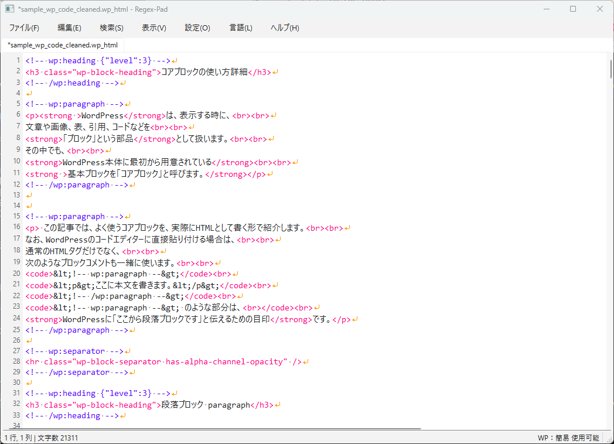
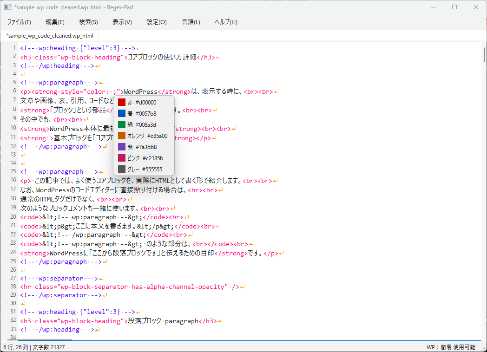

# RegexPad 使い方ガイド

**Release: 1.0.0 (Stable)**

**リリース：1.0.0 安定版**

リリース日：2026年10月25日

[README](../README_jp.md) · [English user guide](../docs/HOW_TO_USE.md)

Windows向けEXE版と、同じ機能を持つソース版の操作を説明します。
特記のない保存先は、`regex-pad.exe`のあるフォルダーを基準にした相対パスです。
メニュー名は日本語画面に合わせています。**言語 > 日本語**で切り替えられます。

## 目次

- [初回起動](#初回起動)
- [ファイルとタブと文字コード](#ファイルとタブと文字コード)
- [検索と置換](#検索と置換)
- [タグとCSSと記事変換](#タグとcssと記事変換)
- [文法チェック](#文法チェック)
- [WordPressプレビュー](#wordpressプレビュー)
- [表示設定と参考資料](#表示設定と参考資料)
- [バックアップと復元](#バックアップと復元)
- [保存場所と削除](#保存場所と削除)
- [ショートカット一覧](#ショートカット一覧)
- [困ったとき](#困ったとき)
- [開発と配布](#開発と配布)

## 初回起動

1. 配布ZIPを、書き込み可能なフォルダーへすべて解凍します。
   EXEと`_internal`を、配布時の配置のまま保持してください。
2. `regex-pad.exe`を起動します。完全同梱版ではPythonやWordPressの別途導入は不要です。
3. **言語**メニューから、日本語・英語を選びます。
4. `Ctrl+O`で原稿を開くか、`Ctrl+N`で新しいタブを作成します。
5. `Ctrl+,`でオプションを開き、文字コード・改行・表示・チェック・バックアップを確認します。

通常の編集はオフラインで使えます。完全同梱版にはローカルプレビュー環境が入っています。
その環境を省いた軽量ビルドでは、利用者が初めてプレビューを実行した際に不足資材を取得します。
初回の取得と準備には時間がかかることがあります。



本文欄に表示されるのはソースです。ステータスバーの左側に行・列・文字数など、
右側にWordPressの状態を表示します。配色や空白記号の表示は設定によって変わります。

## ファイルとタブと文字コード

| 操作 | メニュー・方法 |
|---|---|
| 新しい原稿を作成 | **ファイル > 新規**、`Ctrl+N` |
| ファイルをタブで開く | **ファイル > 開く**、`Ctrl+O` |
| 現在の原稿を保存 | **ファイル > 保存**、`Ctrl+S` |
| 保存先・出力文字コードを指定 | **ファイル > 名前を付けて保存**、`Ctrl+Shift+S` |
| ディスクから読み直す | **ファイル > 読み直し**、または**文字コードを指定して読み直し** |
| タブを閉じる・複製・別ウィンドウへ移動 | タブ名を右クリック |

タブ名やタイトルの`*`は、未保存の変更を示します。
原稿ファイルを更新するときは、明示的に保存してください。
自動復元用のコピーを作っても、原稿ファイルそのものは更新されません。
複製したタブは未保存のコピーになります。
変更済みタブを閉じる際には復元用バックアップを使うため、
一般的な「保存しますか」の確認画面を前提にせず、閉じる前に保存してください。

文字化けする場合は、**文字コードを指定して開く**、または
**文字コードを指定して読み直し**を使います。
対応する文字コードは、UTF-8、UTF-8 with BOM、CP932 / Shift_JIS、Shift_JIS、
EUC-JP、UTF-16、UTF-16 LE、UTF-16 BEです。
開く・読み直す際に選んだ文字コードは、別の指定をするまで保存時にも使用します。
改行コードはオプションからLF・CRLF・CRを選べます。
文字化けしている原稿は、正しい文字コードで読み直してから保存してください。

元に戻す操作は`Ctrl+Z`、やり直しは`Ctrl+Y`または`Ctrl+Shift+Z`です。
矩形コピーは、コピーしたい領域の対角となる位置を始点・終点として選択してから、
**編集 > 矩形としてコピー**（`Ctrl+Alt+C`）を実行します。
列ごとの切り出しをクリップボードへコピーし、元の本文は削除しません。

## 検索と置換

**検索 > 検索 / 置換**（`Ctrl+F`）を開きます。
入力欄は、**検索文字列 → 除外条件 → 置換文字列**の順です。

1. 検索する文字列を入力します。Pythonの`re`構文を使う場合は、**正規表現**を有効にします。
2. 大文字・小文字の区別と、単語単位の条件を設定します。
3. 範囲を限定する場合は、対象を選択してから**選択範囲内だけを検索する**を有効にします。
   **表示中の範囲だけを検索する**も利用できます。
4. **検索**または前後の矢印で、一致位置を確認します。
5. **プレビュー**で、置換前・置換後の行を比較します。
6. 1か所なら**置換**、指定範囲の全件なら**すべて置換**、
   現在の検索マーカーを対象にするなら**マーカー部分を全て置換**を使います。

検索・ハイライト・プレビューは原稿を変更しません。
不正な正規表現や置換参照はエラーとして表示します。
置換結果が意図と違った場合は、元に戻してください。
選択範囲・表示範囲の指定を解除すると、文書全体を対象に戻せます。

### 正規表現の例

| 目的 | 検索文字列 | 置換文字列 |
|---|---|---|
| 連続した数字を探す | `\d+` | 検索だけなら使用しません |
| 連続した半角スペースを1個にする | ` {2,}` | 半角スペース1個 |
| 年-月-日を日/月/年へ変える | `(\d{4})-(\d{2})-(\d{2})` | `\g<3>/\g<2>/\g<1>` |

これらの例では正規表現を有効にしてください。
置換側はPython形式の`\1`、`\g<1>`に加え、互換形式の`$1`、`${name}`も使えます。
正規表現置換でドル記号自体を入れる場合は`$$`を使います。
正規表現を無効にした場合は、入力を通常の文字列として扱います。
**正規表現挿入**・**正規表現レシピ**・**正規表現ヘルプ**で候補と説明を確認できます。
レシピを選んだ後も、置換を実行する前に内容を確認してください。

### 除外条件

正規表現を有効にし、次のように指定すると、例に挙げたタグの直後を除いて改行を検索できます。

```text
検索文字列:  \n
除外条件:    <br><br>\n|>\n
```

`|`は複数の候補をつなぐ記号です。先頭の`-`に除外の意味はありません。
検索結果の文字範囲が除外条件の一致範囲と重なると、その検索結果を対象から外します。
行全体を保護する指定ではなく、文字幅が0の除外一致も文字を保護しません。
除外欄を空にすると、除外を無効にできます。

正規表現・大文字小文字の条件は除外にも適用し、単語単位の条件は検索文字列だけに適用します。
正規表現が無効なら、除外条件も1つの通常文字列です。
検索ハイライト・置換プレビュー・検索に属する各置換操作にも同じ除外を適用します。
選択範囲・表示範囲を限定した場合、除外条件もその範囲内で評価します。
CRLF文字を含む対象では、検索側・除外側ともに`\r?\n`で条件をそろえてください。
ダイアログの入力は使用中のセッションで保持し、再起動後までは保存しません。

### 正規表現書き換え

**正規表現書き換え**は、検索・置換とは別に、指定した変換を実行する機能です。
句読点や全角・半角を変換し、半角カタカナ、英字、数字、記号、空白などを扱います。
対象は選択範囲・表示範囲の指定に従い、指定がなければ文書全体です。
変換を選択すると本文を変更するため、結果を確認し、必要なら元に戻してください。
検索用の**除外条件は、この独立した書き換え操作の保護条件にはなりません**。

## タグとCSSと記事変換

本文を右クリックすると、**タグ挿入**・**文字色**・**CSS挿入**・
**段落分割**・**HTMLエスケープ変換**などを使えます。
**編集 > タグ挿入...**（`Ctrl+Shift+T`）では、候補を検索して選べます。
HTML・Markdown・WordPress HTMLに対応し、ファイル種別で候補の表示順が変わります。
候補の説明と、挿入後に入力するパラメーターを確認してください。



- 文字列を選択して`Ctrl+B`を押すと`<strong>`、`Ctrl+U`なら`<u>`で囲みます。
- **文字色**メニューと、既定の`Ctrl+Alt+1`～`Ctrl+Alt+7`は、選択文字を色付きのspanで囲みます。
  `Ctrl+Alt+R`も既定では赤文字です。
- **CSS挿入 > color: ;**と**background-color: ;**では色見本を選べます。
  自分で色を書く場合は`Esc`で候補を閉じ、CSSの色値を入力します。
- `F8`は`<br>`、`F9`は`<br><br>`を挿入します。
  対応する検索・置換入力欄でも利用できます。
- **HTMLエスケープ**は選択したタグを表示用の文字列へ変換します。
  **HTMLエスケープ解除**はエンティティを戻し、**WordPressコードブロック化**はコード例を整えます。

Markdownの表・リストをWordPress用にする場合は、対象を選択して**段落分割**を開きます。
**表変換**・**リスト変換**・**Markdown表/リストをWordPressブロック化**を用途に応じて選ぶと、
内蔵コンバーターが選択範囲をWordPressブロックHTMLへ置き換えます。
**リストを枠囲みに変換**は、MarkdownリストまたはWordPressリストブロックを、
箇条書き記号・番号を文字として表示する1つのカスタムHTML枠へ変換します。
変換後は`F7`とプレビューで確認してください。

これらの変換・装飾・挿入は、利用者が明示的に行う本文編集です。
保存やWordPressへの貼り付けの前に、出力を確認してください。

### 辞書と色プリセット

スニペット辞書は、`html_dict.json`、`markdown_dict.json`、`wordpress_html_dict.json`です。
ソース版では`dictionaries`内、EXE版では同梱資材側にあります。
オプションからユーザー辞書フォルダーと辞書検証を指定できます。
カスタマイズする場合は、コピーを用意して編集してください。

編集可能な`color_presets.json`はEXEの横にあり、未作成なら同梱の既定値から作成します。
`text_colors`が文字色とショートカット、`background_colors`が背景色です。
各項目は`id`、英語・日本語の名前、CSSの`value`を持ち、文字色には`shortcuts`も設定できます。
編集後はRegexPadを再起動します。
編集側JSONに誤りがある場合は、そのファイルを保持したまま、当該起動では同梱の既定値を使います。

ホーバーヒントの設定は、タグメニューとタグ挿入ダイアログのヒント表示を切り替えます。
ヒントを無効にしても、選択中の候補の説明は参照できます。
現在、本文上のタグや文法チェックのマーカーにはホバー説明はありません。

## 文法チェック

1. 調べたいタブを選び、**検索 > 文法チェック**（`F7`）を実行します。
2. 重要度順に並ぶ結果を確認し、クリックして該当行へ移動します。
3. 結果画面を開いたまま修正し、**再チェック**または`F7`で確認し直します。
4. **結果をコピー**で報告を保存・共有できます。
   結果はタブごとに扱い、本文を変更すると古い結果は無効になります。

| 重要度 | 意味 |
|---|---|
| Error | ブロック境界の破損など、修正が必要な構造・構文の問題 |
| Warning | 誤記・配置・互換性など、確認が必要な疑わしい指定 |
| Info | 補足情報。Infoだけの場合は保存前の確認を出しません |

HTMLタグ・属性の誤記と入れ子、未完了タグ、開始タグの後へ出てしまった属性、
CSSの構造・プロパティー・値、Gutenbergコメントの対応、主な親子制約、
ルート要素の形、WordPressコメント内JSONの構文と一部属性値を確認します。
`.css`ファイルはCSSチェックを使い、HTML中の`style`属性や`<style>`内も対象になります。
ここでいうJSONチェックはWordPressブロック属性内が対象で、
独立したJSONファイル全般を検証するコマンドではありません。
保存前のHTML・WordPress表記チェックはオプションから切り替えられます。

引用符内の複数行`style`など、複数行にまたがる開始タグにも対応します。
改行や`<br>`と`<br />`の表記差だけではエラーにしません。
タグの色分けは、文法チェックとは別の表示機能です。

文法チェックに自動修復ボタンはありません。ソースを修正して再実行してください。
内蔵ルールは、Gutenberg全ブロックの`save()`結果、テーマCSS、独自プラグインの定義、
ブラウザーの構文回復を完全再現するものではありません。
プレビューのWordPress実行結果は別枠に表示し、構造チェックの結果とは分けて扱います。
構造に問題が残っていても、ブラウザーにページが表示される場合があります。

実サイトへ渡す際は、元原稿を残し、コードエディターと表示結果を確認してから保存してください。
WordPress側の**「復旧を試みる」**はWordPress自身の処理であり、
復旧後の再保存で元のソース表現が変わることがあります。
ローカルで観察した事例と解析の範囲は、[作業記録](../SCRIPT_STEP.md)を参照してください。

## WordPressプレビュー

どちらのモードも、**現在のタブの未保存内容**をローカルWordPressへ渡して描画します。
実サイトへの公開や、RegexPad本文の書き換えは行いません。
記事・ブロックのソースを確認する用途で、実サイトのテーマ・プラグイン・データベースが
そのまま入っている環境ではありません。

| 項目 | 簡易版 | 本格版 |
|---|---|---|
| メニュー | **表示 > WordPressプレビュー（簡易・自動終了）** | **表示 > WordPressプレビュー（Twenty Twenty-Five・本格）** |
| ショートカット | `Ctrl+Alt+P` | `Ctrl+Alt+Shift+P` |
| 表示 | 中立テーマの本文、コアのブロックCSS、記事内スタイル | 標準テーマTwenty Twenty-Fiveのページ |
| WordPressの保持 | 書き出し後、ブラウザーを開く前に終了 | 明示的な終了または所有するRegexPadウィンドウの終了まで保持 |
| 主な用途 | 文章・色・幅・枠・余白の確認 | テーマの影響と、利用可能なフロント側スクリプトの確認 |

### 簡易版

簡易プレビューを実行し、書き出したHTMLがブラウザーで開くまで待ちます。
専用の中立テーマは`post-content`を表示し、本文幅・wide幅を100%、
テーマ由来のブロック間隔を0、左右余白を`2em`（全角約2文字分）にします。
サイトヘッダー・投稿者・カテゴリー・More Posts・フッターを付けません。
記事内で明示した「最新の投稿」などのブロックは、その内容を描画します。

書き出し先は`Temp/WordPressPreview/`です。
書き出し対象となるローカルCSS・CSS import・フォント・画像を埋め込み、
外部URLは外部参照のまま残します。
JavaScript・イベント属性は省きますが、HTML標準の`details`は動作できます。
ページはWordPress終了後も閲覧できます。
残しておきたい書き出しは、プレビュー資材を削除する前に別の場所へコピーしてください。

### 本格版

本格プレビューを実行すると、標準テーマのページを開きます。
ローカルサーバーが必要な動作の確認中は、RegexPadを起動したままにします。
同梱テーマやコアが提供するスクリプトは動作できますが、
入っていない実サイト専用プラグインのウィジェットなどは確認できません。
ブラウザーだけで動く部品もありますが、ライブページの取得やサーバーへの要求には
WordPressの起動が必要です。

次の本格プレビューは、起動中のプロセスを再利用します。
先に止めたい場合は**表示 > WordPressを終了**を選ぶと、両モードのローカル環境を停止します。
所有するRegexPadウィンドウの終了時にも、そのウィンドウのプロセスを終了します。
サーバー停止後は、開いたままのライブページを再読み込みできません。
簡易版を書き出しても、別途起動中の本格版は終了しません。

### 編集の反映と起動時間

原稿を変更したら、使いたいモードのプレビューを再実行します。
実行するたびに現在のテキストを送ります。
古い簡易版ページを再読み込みしても、その書き出し時点の内容を表示します。
本格版でも、ブラウザーの再読み込みだけではRegexPadの変更を送信しません。
起動短縮に再利用するのは、記事を入れる前の初期デモデータベースです。
過去に描画した記事HTMLを使い回す仕組みではありません。

RegexPad起動から約10秒後、準備済みの簡易環境を、記事を入れず静かに起動し始めます。
不足資材の取得は利用者がプレビューを実行した際に行い、自動タイマーでは取得しません。
ダウンロード・展開・初期化・起動のため、使用可能になるまで10秒以上かかる場合があります。
手動プレビューや「WordPressを終了」を操作すると、待機中の先行起動予定を取り消します。

ステータスバー右の**WP**表示で、待機・未準備・準備・ダウンロード・起動・使用可能・
描画／書き出し・停止・失敗などを確認できます。簡易版と本格版は別々に状態を管理します。
「使用可能」はWordPressから起動完了の応答が届いた状態です。
マウスを重ねると、起動タイミングの説明や失敗の詳細を参照できます。

サーバーは`127.0.0.1`だけで待ち受け、HTTP経由の書き込み要求は拒否します。
WordPressコアとTwenty Twenty-Fiveは変更しません。
作業中の記事・データベースは使い捨ての実行環境に置き、
記事投入前の初期データベースだけを起動用に保存します。
PHP側での外部API・oEmbed処理は、このローカル検証環境の対応範囲外です。
ブラウザーが読む外部画像などは、そのURLへ接続できる必要があります。

## 表示設定と参考資料

**表示**メニューで行番号・右端での折り返し・ルーラーを切り替えます。
**設定 > オプション**（`Ctrl+,`）では、フォント、タブ幅、配色、検索マーカー、
空白・タブ・改行の可視化、指定文字数での折り返しなどを設定します。
可視化記号や折り返しは画面上の表示で、本文に記号や改行を挿入する操作ではありません。
ルーラー上をクリックすると、指定文字数での折り返しが有効な場合に使う列を選べます。

`F1`はアプリ内の使い方を開きます。
**ヘルプ > HTML / CSS / WordPress 参考表**は、本文を編集しながら開いておける参考画面です。
参考表は同梱のLintスキーマから作成します。
この独立した操作ガイドには、英語版も用意しています。

## バックアップと復元

バックアップは用途の異なる2種類です。

| 種類 | 既定の保存先 | 内容 |
|---|---|---|
| 保存済みファイルの世代 | `_internal/backup/` | 上書き保存する前のファイル内容 |
| 未保存セッション・履歴 | `_internal/autosave/` | 変更済みタブの復元用コピー。最新データは`unsaved_backup.json`を含む |

オプションで、保存済みファイルのバックアップ先、保持数・保持日数、
自動バックアップ間隔、起動時の復元を設定できます。
既定値は保存済みファイルの20世代・30日と、3分ごとの自動スナップショットです。
最新の復元データは編集時や、内容を失う可能性のある操作の前にも更新します。
バックアップは明示的な保存を補うもので、原稿ファイルを直接更新するものではありません。

復元するときは対象ファイルのタブを選び、**ファイル > バックアップから復元**を開きます。
保存前の世代、または利用可能な未保存セッションのスナップショットを選んでください。
復元後の本文を確認し、保存します。両方残したい場合は名前を付けて保存します。
保存済みファイルのバックアップ復元は、変更済みの本文としてエディターへ読み込み、
その場で元ファイルを上書きする処理ではありません。
起動時の復元が有効で復元データがある場合は、起動時にも案内します。

## 保存場所と削除

| パス | 保存するもの |
|---|---|
| `config.json` | アプリのローカル設定 |
| `color_presets.json` | 編集可能な文字色・背景色・ショートカット |
| `_internal/` | 必須の同梱資材と、既定のバックアップ先 |
| `_internal/runtime/wordpress-preview/` | 完全同梱EXE版のプレビュー環境 |
| `runtime/wordpress-preview/` | 必要時の取得・ソース版のプレビュー資材 |
| `Temp/WordPressPreview/` | 書き出しページ、起動用キャッシュ、プレビュー作業ファイル |
| `modules/`・`runtime/venv/` | 利用した場合のアプリ内追加Python資材 |
| `install_records/` | 導入・削除の記録と、読める形式の保存先一覧 |

設定はローカルファイルです。アプリから永続的なシステム環境変数やレジストリーキーは作成しません。
実行時の環境変数設定は、そのプロセス内だけに適用します。
一時的なLint結果はWindowsの一時フォルダー内の`regex_pad/lint_results`へ保存し、
最後のエディターウィンドウを閉じた際に整理します。

EXE起動時に、`_internal/DELET_ITEMS_LIST.md`と
`install_records/DELET_ITEMS_LIST.md`を作成します。
資材の準備・書き出し・モジュール導入・通常の終了時にも更新します。
構造化した記録は`install_records/deletion_inventory.json`です。
既知の対象範囲のパス、パッケージ名・バージョン、設定ファイルの場所、
関連する環境変数の参照先を、準備途中の資材も含めて記録します。
設定ファイルの内容や、PC全体を調査する一覧ではありません。
自動生成の目印より外側へ書いた手動メモは、更新後も保持します。

共有の可能性があるパスは、後半の次の見出しにまとめます。

```text
# (警告)共有する可能性が高いファイル
## 以下のファイル・フォルダなどは、他のソフトから共有されている可能性が有ります。
```

そこに記載する参照先は、自動削除の対象に追加しません。
手動で削除する際は、所有元と他のアプリの利用状況を確認してください。
アプリフォルダーを削除する前に、この一覧を別の場所へ保管しておくと参照できます。

プレビュー・追加モジュールの整理は、RegexPadを終了してから、EXEのある場所で実行します。

```powershell
.\module_cleaner.exe --dry-run
.\module_cleaner.exe --clean
```

`--dry-run`は候補の一覧表示です。`--clean`は削除前に`DELETE`の入力を求めます。
アプリ所有として記録した追加資材と、表中のWordPress用3フォルダーが対象なので、
`Temp/WordPressPreview/`内の書き出し済みページも含まれます。
アプリの全ファイルやバックアップを一括削除するコマンドではありません。
別のポータブルフォルダーやソース版を指定する場合は`--app-root <folder>`を使います。
外部パス・リンク・ジャンクションは拒否し、ロックなどで削除できない場合は
`install_records/cleaner_report.json`に記録して、非0の終了コードを返します。
同梱のプレビュー環境を削除した場合、次の利用時に環境の準備が必要になります。

## ショートカット一覧

| キー | 操作 |
|---|---|
| `Ctrl+N` / `Ctrl+O` | 新規 / 開く |
| `Ctrl+S` / `Ctrl+Shift+S` | 保存 / 名前を付けて保存 |
| `Ctrl+Z` | 元に戻す |
| `Ctrl+Y` / `Ctrl+Shift+Z` | やり直し |
| `Ctrl+A` | すべて選択 |
| `Ctrl+Alt+C` | 矩形としてコピー |
| `Ctrl+F` | 検索 / 置換 |
| `F7` | 文法チェック |
| `F8` / `F9` | `<br>` / `<br><br>`を挿入 |
| `Ctrl+B` / `Ctrl+U` | 選択範囲を`<strong>` / `<u>`で囲む |
| `Ctrl+Alt+1` ～ `Ctrl+Alt+7` | 既定の文字色：赤・青・緑・オレンジ・紫・ピンク・グレー |
| `Ctrl+Alt+R` | 既定の赤文字ショートカット |
| `Ctrl+Shift+T` | タグ挿入ダイアログ |
| `Ctrl+Alt+P` | 簡易WordPressプレビュー |
| `Ctrl+Alt+Shift+P` | 本格WordPressプレビュー |
| `Ctrl+,` | オプション |
| `F1` | アプリ内の使い方 |
| `Alt+F4` | ウィンドウを閉じる |

文字色のキーは`color_presets.json`で変更できます。
エディターでは、通常のコピー・切り取り・貼り付けのショートカットも使えます。

## 困ったとき

| 症状 | 確認すること |
|---|---|
| EXEだけコピーしたら起動・資材読み込みに失敗 | `_internal`を含む配布一式を、書き込み可能な場所へ解凍します |
| 文字化けする | 保存する前に、正しい文字コードで開き直す・読み直す操作をします |
| 置換されない場所がある | 除外、大文字小文字・単語条件、選択／表示範囲、マーカーを確認します |
| プレビューに変更が出ない | 編集したタブから再実行します。ブラウザーの再読み込みだけでは原稿を送りません |
| 10秒経ってもWPが使えない | WP状態を見ます。初回の取得・準備・実起動には別途時間がかかります |
| プレビュー準備が失敗する | 状態のヒントと`runtime/wordpress-preview/`の準備ログを確認し、不足資材の取得に必要な接続を確認します |
| 簡易版のボタンが動かない | JavaScriptが必要なら本格版で確認します。実サイト固有プラグインは両モードに入っていません |
| テーマの余白が記事へ影響する | 簡易版の中立テーマで確認します |
| Lint結果とブラウザー表示が違う | 構造が壊れていても描画できる場合があります。両方を確認して再チェックします |
| エラーマーカーにホバー説明が出ない | 本文マーカーのホバー説明は未対応です。`F7`の結果から該当行へ移動します |
| cleanerで削除できない | 使用中のプロセスを閉じ、`cleaner_report.json`と`DELET_ITEMS_LIST.md`を参照します |

## 開発と配布

ソースの保守環境はPython 3.12・PySide6です。
プロジェクトフォルダーで、指定されたPythonを使います。

```powershell
& "D:\Dev\venvs\venv_txt_edit312\Scripts\python.exe" main.py
& "D:\Dev\venvs\venv_txt_edit312\Scripts\python.exe" -m pytest
& "D:\Dev\venvs\venv_txt_edit312\Scripts\python.exe" -m ruff check .
& "D:\Dev\venvs\venv_txt_edit312\Scripts\python.exe" -m pyright --pythonpath "D:\Dev\venvs\venv_txt_edit312\Scripts\python.exe"
```

`./build.ps1`はWordPressとポータブルNodeを準備し、
完全同梱版を`dist/regex-pad/`へ作成します。
`./build.ps1 -SkipWordPressRuntime`ではプレビュー環境を省きます。
標準ビルドは、作成PCにNodeがあっても配布用Nodeを含めるため、利用者のグローバル導入は不要です。
初回の資材取得にはネット接続が必要です。各実行部品のライセンスファイルも同梱します。
配布する際は、onedirフォルダー全体を保持してください。

specを直接使う場合は、同じPythonで先に`-m preview.package_runtime`を実行します。
spec直接実行で軽量版を作る場合は、`REGEXPAD_SKIP_WORDPRESS_RUNTIME=1`を指定できます。
準備先はプロジェクトの`runtime/wordpress-preview/`で、グローバル導入は行いません。
現在の実行部品はPlayground 3.1.60・PHP 8.3と、対応するNode 24.18以降です。

任意の実エンジン検証は、同じPythonによる`-m preview.verify_wordpress_preview`と
`-m preview.verify_preview_modes`です。環境の準備を行う場合があり、
通常のオフラインpytestとは別の検証です。
前者は`--theme twentytwentyfive`でも実行できます。
テーマと起動用キャッシュの検証には、Node標準のテストランナーを使います。

```powershell
node --test tests/wordpress_preview_theme.test.mjs tests/wordpress_preview_boot_cache.test.mjs
```

リリース時の検証は[作業記録](../SCRIPT_STEP.md)へ記載し、
自動テスト・EXE版・実画面・実サイトでの確認を区別します。
既存の解析資料とbroken/fixedテスト素材は回帰確認の基準に使えます。
WordPressの復旧出力は観察資料であり、そのまま正しい原稿の基準にはしません。
